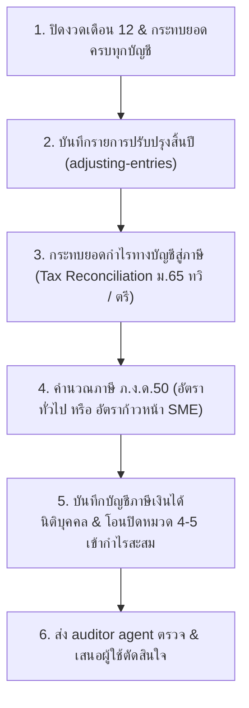

# Year-End Close & Annual Corporate Tax: ภ.ง.ด.50 (ปิดบัญชีสิ้นปีและภาษีนิติบุคคล)

Read `Accountant/lessons/year-end-close.md` first if it exists. Consult `thai-accountant`
(`skills/thai-accountant/references/tax-accounting.md`, `skills/thai-accountant/references/reporting-disclosure.md`) for tax laws and TFRS standards.

Annual close transforms 12 months of reconciled accounting records into statutory financial
statements and determines annual corporate income tax under the Thai Revenue Code.

---

## 1. Statutory Deadlines

| Filing | Paper Deadline | e-Filing Deadline | Authority |
|---|---|---|---|
| ภ.ง.ด.50 (Annual CIT) | Within 150 days from fiscal year end (e.g. May 30 for calendar year) | +8 days (approx June 7) | Revenue Department |
| Annual Financial Statements (ส.บช.3) | Within 5 months from fiscal year end (May 31 for calendar year) | Same | Department of Business Development (DBD) |

---

## 2. Year-End Closing Workflow

---

## 3. Tax Reconciliation (กระทบยอดกำไรทางบัญชีสู่กำไรสุทธิทางภาษี)

Accounting Net Profit (Loss) before Tax (กำไรสุทธิทางบัญชีก่อนภาษี)
**ADD: Non-deductible expenses under Section 65 Ter (บวกกลับ: รายจ่ายต้องห้ามตามมาตรา 65 ตรี)**
1. Personal expenses, gifts, donations exceeding statutory caps (ม.65 ตรี (3)).
2. Entertainment expenses exceeding 0.3% of revenue or paid-up capital, whichever is greater, max 10M THB, gifts max 2,000 THB per person per occasion, or lacking proper documentation (Ministerial Regulation No. 143, clause 4, as amended / ม.65 ตรี (4)).
3. Capital expenditures booked as operating expenses (ม.65 ตรี (5)).
4. Tax penalties, surcharges, and criminal fines (ม.65 ตรี (6)).
5. Input VAT claimable as credit, or non-creditable input VAT due to prohibited categories (ม.65 ตรี (6 ทวิ)).
6. Provisions and estimated reserves not yet realized or paid (ม.65 ตรี (1)).
7. Expenses lacking valid recipient evidence, or unidentifiable payees (ม.65 ตรี (18)).
8. Book depreciation exceeding statutory tax depreciation rates under Royal Decree No. 145.

**LESS: Tax-exempt income and additional tax incentives (หัก: รายได้ยกเว้นและรายจ่ายหักได้เพิ่ม)**
1. Dividend income received from Thai companies (exempt 50% or 100% under Section 65 Bis (10)).
2. Additional deduction for employee training expenses (200% deduction under Royal Decree No. 437).
3. Additional capital expenditure incentives under active government economic decrees.
4. Tax depreciation exceeding book depreciation (e.g. SME 40% initial machine allowance).
5. Carried-forward tax losses not exceeding 5 consecutive fiscal years (ม.65 ตรี (12)).

**EQUALS: Taxable Net Profit (กำไรสุทธิเพื่อเสียภาษี)**

---

## 4. CIT Computation & Tax Credits

1. **Calculate Tax Liability:**
   - **Qualifying SME** (Paid-up capital on last day of fiscal year ≤ 5,000,000 THB AND total revenue ≤ 30,000,000 THB):
     - Net profit 0 to 300,000 THB: 0%
     - Net profit 300,001 to 3,000,000 THB: 15%
     - Net profit above 3,000,000 THB: 20%
   - **General Company:** 20% flat.
2. **Deduct Tax Credits:**
   - Half-year tax paid under Form ภ.ง.ด.51.
   - Total Withholding Tax deducted from revenue throughout the full year (verified against all original 50 Tawi certificates).
3. **Net Tax Payable / Refundable:**
   - If positive: Net tax to pay by deadline.
   - If negative: Tax overpaid (eligible for tax refund or credit carry-forward).

---

## 5. Year-End Closing Journal Entries

1. **Tax Expense Entry:**
   `Dr. Corporate Income Tax Expense (ค่าใช้จ่ายภาษีเงินได้)`
   `Cr. Prepaid Tax - ภ.ง.ด.51 (ภาษีจ่ายล่วงหน้าครึ่งปี)`
   `Cr. Prepaid Tax - WHT Credits (ภาษีถูกหัก ณ ที่จ่าย)`
   `Cr. Accrued Corporate Income Tax (ภาษีเงินได้นิติบุคคลค้างจ่าย — if payable)`
   *(Or `Dr. Refundable Tax Receivable` if refund claimed)*
2. **Closing Revenue & Expense to Retained Earnings:**
   `Dr. Revenue Accounts (All หมวด 4)`
   `Cr. Expense Accounts (All หมวด 5)`
   `Cr. Corporate Income Tax Expense`
   `Cr. / Dr. Retained Earnings - Unappropriated (กำไรสะสมยังไม่ได้จัดสรร)`

---

## 6. Output

Thai summary package:
- 12-month trial balance comparison (Pre-close vs Post-close).
- Detailed Tax Reconciliation statement referencing Revenue Code sections.
- Form ภ.ง.ด.50 calculation schedule with source formula links.
- List of original 50 Tawi tax certificates reconciled.
- Items requiring user confirmation (approval of tax draft, tax refund decision, signing CPA).

## Learn and remember (every job)
- **Before:** read `Accountant/lessons/year-end-close.md` if it exists. Search first with `accountant-graph`
  (tool `accountant_find` on the names, document numbers, forms and period in the request) and
  look up `Accountant/memory/` with `accountant-memory`.
- **During:** note what you read (file, sheet, range; email subject), each formula or rate you
  use, and every problem as it happens.
- **After:** record the job with the tool `accountant_job` (one call writes the ledger entry, the
  catalog lines and the links; if the tool is not available, follow the manual steps in
  `accountant-memory`) and say "บันทึกงาน J-id". If the user corrected the work, a check failed
  and was fixed, or a step here was wrong or missing, save one lesson with the tool
  `accountant_lesson` (rules in `learn-and-improve`). Record verified decisions and party
  treatments. Say in one line what was saved.
